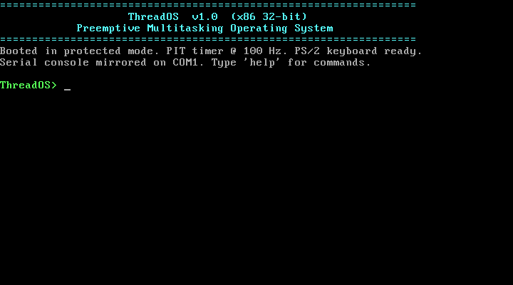
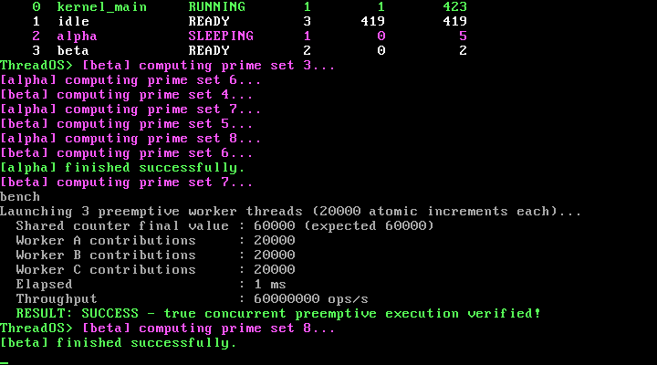
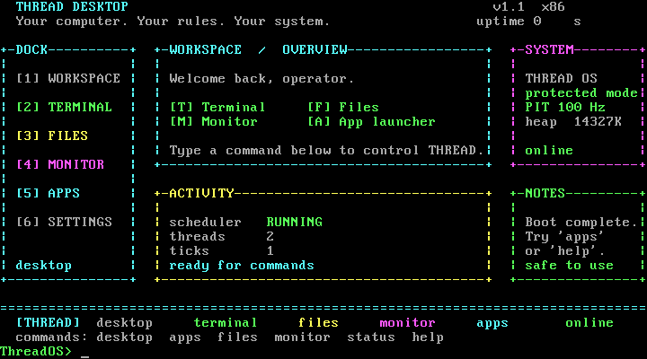
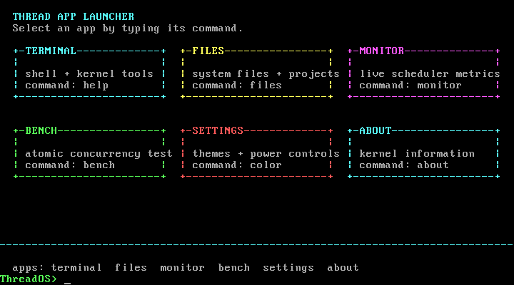
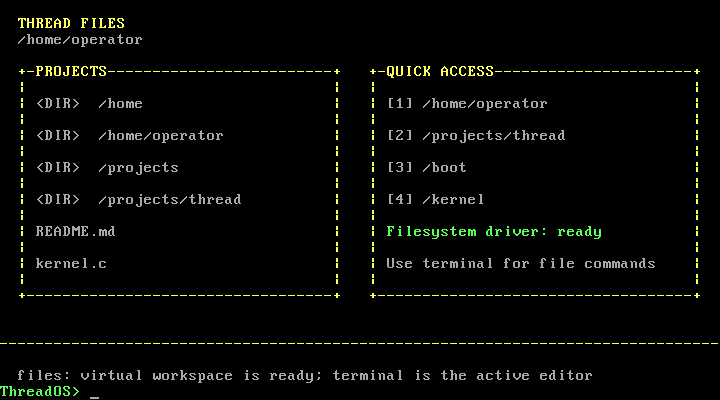
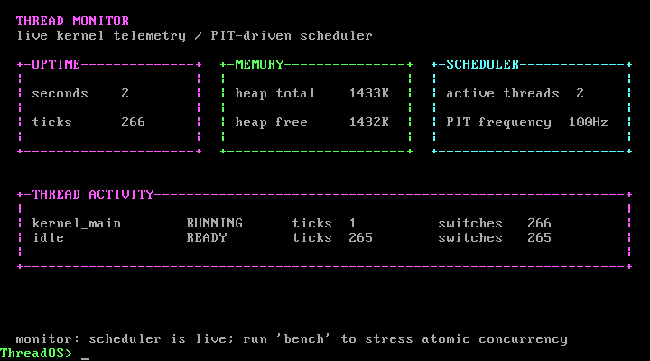
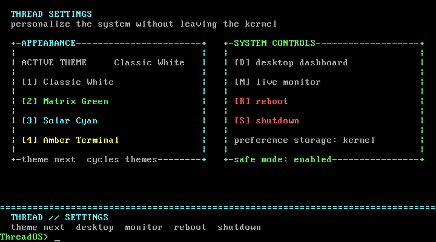

<div align="center">
  
  <h1>THREAD OS</h1>
  <p><strong>Your computer. Your rules. Your system.</strong></p>
  <p>A real, bootable 32-bit x86 preemptive multitasking operating system — with a Linux-based desktop edition on the roadmap.</p>

  <a href="README.md"></a>
  <a href="README.ru.md"></a>
  <a href="README.de.md"></a>
  <a href="README.az.md"></a>

  <br><br>
  <a href="#-project-status"></a>
  <a href="docs/ARCHITECTURE.md"></a>
  <a href="LICENSE"></a>
  <a href="https://github.com/jamilislamov642-cell/thread-os/releases"></a>
</div>

---

## ✦ Welcome to THREAD

THREAD OS is an ambitious operating-system project by **Jamil Islamov**.

> **Honest status:** **THREAD OS is now a real, verified bootable operating system.** This repository now includes a genuine 32-bit x86 preemptive multitasking kernel, a stage-1 MBR bootloader, a priority round-robin scheduler driven by the PIT timer at 100 Hz, an interactive shell, and an automated QEMU test suite where **23/23 checks pass**. Bootable floppy/USB disk images and ISOs are built from source and attached to each [Release](https://github.com/jamilislamov642-cell/thread-os/releases). The higher-level Linux-based desktop distribution remains a future milestone on the [roadmap](ROADMAP.md).





### THREAD Desktop v1.1

The native kernel now boots directly into a real VGA desktop dashboard inspired by the supplied THREAD Desktop design: a dock, workspace overview, system panel, notes panel, activity panel, status bar, and command prompt. These are not browser mockups — each view is drawn into VGA memory by the kernel and backed by live timer, heap, and scheduler data.











## ✧ Explore THREAD

| Get started | Project design | Help build it |
|:--|:--|:--|
| [**⚙ Build guide**](BUILD.md) · [**📖 User guide**](docs/USER_GUIDE.md) | [**⌘ Architecture**](docs/ARCHITECTURE.md) · [**◷ Roadmap**](ROADMAP.md) | [**✚ Contributing**](CONTRIBUTING.md) · [**☷ Issues**](https://github.com/jamilislamov642-cell/thread-os/issues) |

### Quick links

[🚀 **Build**](BUILD.md) &nbsp; [📦 **User Guide**](docs/USER_GUIDE.md) &nbsp; [🧭 **Architecture**](docs/ARCHITECTURE.md) &nbsp; [🗺 **Roadmap**](ROADMAP.md) &nbsp; [🤝 **Contribute**](CONTRIBUTING.md) &nbsp; [🌐 **Website**](https://jynza.cc)

## ⚡ Quick Start

### Build from source

```bash
# Ubuntu / Debian
sudo apt-get install gcc nasm qemu-system-x86 xorriso mtools make
# On ARM64 also install the cross-compiler:
sudo apt-get install gcc-i686-linux-gnu

make
```

### Run

```bash
# Graphical VGA window
./scripts/run.sh

# Headless serial console inside your terminal (Ctrl-A then X to exit)
./scripts/run.sh --serial

# Boot from the ISO image
./scripts/run.sh --iso
```

### Verify

```bash
./scripts/test.sh
```

All 23 assertions (bootloader, desktop startup, app launcher, Files, Monitor, status center, Settings, theme cycling, async thread spawning, background prime computation, atomic concurrency counting, and shutdown) pass automatically.

## ⌨ Shell Commands

| Command | Description |
|---|---|
| `desktop` / `workspace` | Return to the THREAD Desktop dashboard |
| `apps` / `launcher` | Open the real VGA app launcher |
| `files` | Open the THREAD Files view |
| `monitor` | Open live scheduler and memory telemetry |
| `status` | Show subsystem health status |
| `settings` / `theme` | Open personalization and system controls |
| `theme next` | Cycle themes and redraw the desktop |
| `open <app>` | Open `desktop`, `files`, `monitor`, or `apps` |
| `help` | Show all available commands |
| `threads` / `ps` | Live formatted thread table (state, priority, ticks, switches) |
| `spawn <name> [prio]` | Launch a background worker computing primes asynchronously (priority 0–3) |
| `kill <tid>` | Terminate a thread by ID |
| `bench` / `stress` | Preemptive concurrency benchmark (60,000 atomic increments across 3 threads) |
| `ticker` | Toggle background uptime ticker thread |
| `matrix` | Toggle matrix digital rain demo |
| `sleep <ms>` | Put the shell thread to sleep (other threads keep running) |
| `mem` | Kernel heap and thread stack statistics |
| `uptime` | System uptime in seconds and h:m:s |
| `color` | Cycle VGA color themes |
| `clear` | Clear screen |
| `about` | System information and architecture |
| `reboot` | Reset CPU |
| `shutdown` | Power off the VM (ACPI) |

## ◈ Project Status

| Area | Status |
|:--|:--|
| MBR stage-1 bootloader + 32-bit protected-mode entry | **Implemented and boot-tested** |
| IDT (256 gates), PIC remapping, CPU exception handlers | **Implemented and tested** |
| PIT 8254 timer @ 100 Hz with preemptive scheduling | **Implemented and tested** |
| Low-overhead assembly context switcher (`switch_to`) | **Implemented and tested** |
| Priority round-robin scheduler + time slices | **Implemented and tested** |
| PS/2 keyboard + COM1 serial mirroring + VGA text console | **Implemented and tested** |
| Dynamic 14 MB kernel heap allocator | **Implemented and tested** |
| Spinlocks, mutexes, atomic counters | **Implemented and tested** |
| Interactive shell with thread management | **Implemented and tested** |
| THREAD Desktop dashboard + VGA app views | **Implemented and tested** |
| Settings screen + four live themes | **Implemented and tested** |
| Automated QEMU test suite (23/23 PASS) | **Verified** |
| Bootable floppy/USB image + El Torito ISO | **Generated by `make`** |
| Native THREAD Desktop dashboard + text-mode app views | **Implemented and tested** |
| Graphical installer | Planned on the [roadmap](ROADMAP.md) |
| Linux-based desktop distribution release | Planned on the [roadmap](ROADMAP.md) |

## ⌘ Technical Direction

THREAD OS follows a two-tier strategy:

1. **Native bare-metal tier (implemented, v1.2):** a 32-bit x86 protected-mode kernel with real multitasking, interrupt-driven preemption, context switching in assembly, a kernel-rendered THREAD Desktop dashboard, app views, live monitoring, settings, and a console shell. This gives the project a genuine, verified bootable foundation and proves the scheduler/concurrency design on real hardware semantics.
2. **Linux-based desktop tier (planned):** an x86_64 desktop edition with GRUB (BIOS + UEFI), the THREAD desktop experience (launcher, panel, settings, workspace restore), a custom installer, and the THREAD application suite.

See [docs/ARCHITECTURE.md](docs/ARCHITECTURE.md) for the native kernel internals and [ARCHITECTURE.md](ARCHITECTURE.md) for the long-term system vision.

## 🗂 Repository Map

```text
boot/           Stage-1 MBR bootloader
bootloader/     GRUB configuration and boot notes (Linux tier)
kernel/         Native kernel source (C + ASM) and Linux kernel notes
drivers/        Hardware support strategy
desktop/        THREAD desktop design
applications/   Application concepts and implementation notes
system/         Service and workspace design
filesystem/     Filesystem and disk layout design
networking/     Networking design
security/       Security model
themes/         Visual theme configuration
assets/         Brand assets
scripts/        run.sh, test.sh, and ISO build tooling
tests/          Validation notes
docs/           Architecture guide, user guide, screenshots
documentation/  Technical documentation
iso/            ISO staging notes
```

## 🧵 Project Principles

1. **Real over theatrical:** every claim must be backed by code and tests.
2. **Honest claims:** document what is implemented and what has actually been tested.
3. **User control:** make risky disk and bootloader operations explicit and consent-based.
4. **Maintainable foundations:** keep the codebase small, readable, and well tested.
5. **Accessible customization:** make the system's appearance and behavior adaptable.

## 🤝 Contribute

Contributions and constructive feedback are welcome. Start with [CONTRIBUTING.md](CONTRIBUTING.md), then browse [open issues](https://github.com/jamilislamov642-cell/thread-os/issues) or [create an issue](https://github.com/jamilislamov642-cell/thread-os/issues/new/choose).

## About

**THREAD OS** · Founder: **Jamil Islamov** · [jynza.cc](https://jynza.cc) · [MIT License](LICENSE)

<div align="center">
  <sub>Built with a clear roadmap, open development, and no pretend progress.</sub><br>
  <a href="#-welcome-to-thread">↑ Back to top</a>
</div>
